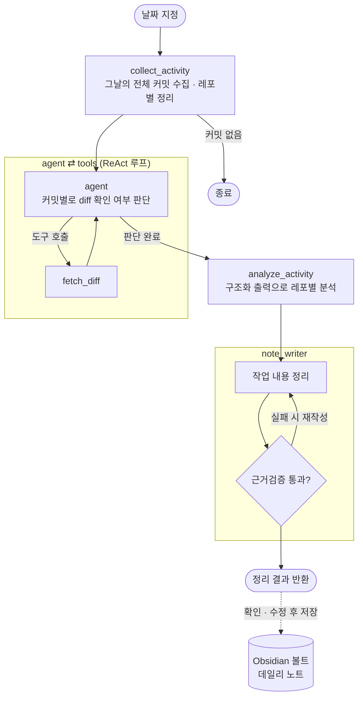

# DevLog Agent

> GitHub 커밋과 실제 코드 변경 내역(diff)을 근거로 그날의 개발 작업 내용을 정리해, Obsidian 데일리 노트로 남겨주는 LLM 에이전트

---

## 소개

하루 동안 무엇을 개발했는지 정리해 두면 작업 이력을 관리하고 나중에 돌아보기 좋지만, 매일 직접 쓰기는 번거롭습니다.
그런데 그날 한 작업은 이미 GitHub 커밋과 코드 변경 이력에 가장 정확하게 남아 있습니다.

DevLog Agent는 이 기록을 읽어 하루의 작업 내용을 자동으로 정리합니다. 단, 커밋 메시지만 요약하면 실제로 코드가 어떻게
바뀌었는지 확인하지 않은 채 그럴듯한 문장을 만들어낼 수 있습니다. 그래서 이 에이전트는 **"실제로 한 작업만 적는다"** 를
원칙으로 합니다.

## 요구사항

### 기능

| 기능 | 설명 |
|---|---|
| 일일 활동 수집 | 지정한 날짜(기본: 어제)에 작성한 커밋을 모든 레포에서 모아 레포별로 묶습니다 |
| 근거 기반 분석 | 커밋마다 메시지만으로 충분한지, 실제 코드 변경(diff)까지 확인해야 하는지 에이전트가 판단합니다 |
| 작업 내용 정리 | 레포별 작업 요약, 주요 변경사항, 커밋 목록을 정리합니다 |
| 근거검증 | 정리된 내용이 실제 커밋·diff에 근거하는지 확인하고, 근거가 부족하면 다시 작성합니다 |
| Obsidian 저장 | 로컬 Obsidian 볼트의 데일리 노트에 저장합니다 |

### 비기능

- **사실과 판단의 분리** — 커밋 목록·레포명·날짜처럼 지어낼 여지가 없는 정보는 LLM이 아니라 코드가 채웁니다.
- **사용자 노트 보존** — 노트에 직접 쓴 내용은 건드리지 않고 자동 생성 영역만 갱신하며, 같은 날짜로 다시 실행해도 결과가 같습니다.
- **자격증명 분리** — GitHub 토큰 등 인증 정보는 환경변수로 관리하고 LLM 입력이나 실행 기록에 남기지 않습니다.
- **로컬 실행** — 볼트가 로컬에 있으므로 서버 배포 없이 로컬에서 명령어로 실행합니다.
- **추적 가능성** — 에이전트의 도구 호출과 판단 흐름을 추적할 수 있어야 합니다.

## 동작 흐름



### 설계 포인트
- **자율 판단과 고정 순서의 분리** — 어떤 커밋의 diff를 볼지는 에이전트가 판단하고, 수집 → 분석 → 정리 → 검증 순서는 그래프
  엣지로 고정합니다. 판단 기준은 시스템 프롬프트에 명시하고, 프롬프트는 YAML 파일로 코드와 분리해 관리합니다.
- **사실 조회는 코드가** — 그날 어떤 커밋이 있었는지는 판단할 일이 아니라 조회할 일이므로, 수집은 LLM이 아닌 고정 노드가 담당합니다.
  diff 조회 도구도 수집된 레포·커밋이 아니면 거부합니다.
- **생성과 저장의 분리** — 그래프는 정리 결과를 만드는 데까지만 담당하고, 저장은 그래프 밖(CLI 실행기, 웹 콘솔)에서 처리합니다.
- **자격증명 분리** — GitHub 토큰은 그래프 상태가 아닌 실행 단위 컨텍스트로 전달해, LLM 입력과 추적 기록에 남지 않게 합니다.

### 커밋 수집
GitHub 커밋 검색 API로 `author:{사용자} author-date:{하루 범위}`를 조회합니다. 날짜 경계는 설정한 시간대(기본 `Asia/Seoul`) 기준입니다.
검색 API는 **기본 브랜치의 커밋만** 검색하므로, 다른 브랜치에만 있는 커밋은 수집되지 않습니다.

## 데일리 노트 형식

`{볼트}/개발기록/26.10.20.md`처럼 날짜별 노트에 저장합니다(폴더·파일명 형식은 설정으로 변경 가능). `<!-- devlog -->` 마커 사이만
자동으로 갱신되므로, 노트에 직접 적어 둔 내용은 그대로 유지되고 같은 날짜로 다시 실행해도 내용이 중복되지 않습니다.
프론트매터는 기존 키를 보존한 채 `devlog_*` 키만 갱신하며, `devlog_status: reviewed`로 바꾼 노트는 덮어쓰지 않습니다.

```markdown
---
date: 2026-10-20
devlog_status: draft
devlog_grounded: true
devlog_repos: [owner/repo]
devlog_commits: 5
---

<!-- devlog:start -->
## 개발 작업 정리

### owner/repo
(작업 요약)

**주요 변경사항**
- ...

**커밋**
- `a1b2c3d` feat: ...
<!-- devlog:end -->
```

## 기술 스택

| 분류 | 기술 |
|---|---|
| 언어 | Python 3.13 (uv) |
| 서버 | FastAPI, Uvicorn |
| 에이전트 | LangGraph, LangChain |
| LLM | Google Gemini (`gemini-3.5-flash-lite`) |
| 관측 | LangSmith |
| 외부 연동 | PyGithub (GitHub API) |
| 저장 | Obsidian (로컬 볼트 마크다운) |
| 프론트엔드 | HTML / CSS / JavaScript |

## 개발 상태

설계를 마쳤고 구현을 시작합니다. 사용 방법은 구현에 맞춰 추가합니다.
